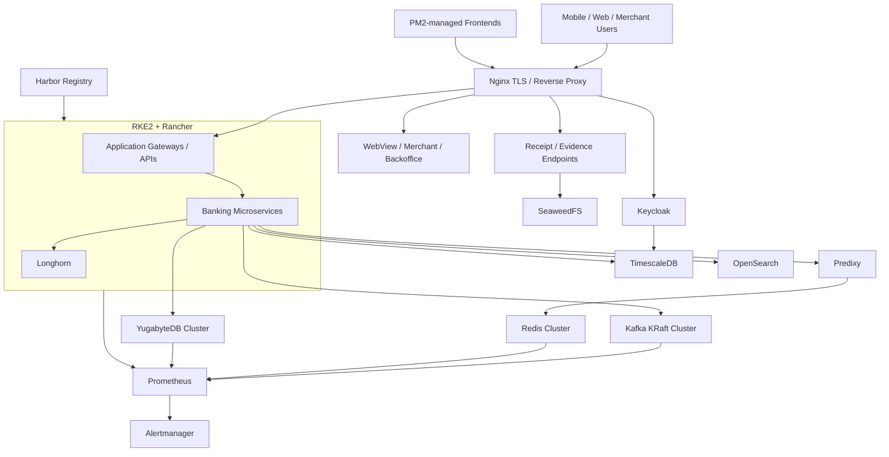

# Banking Digital Platform Infrastructure

Sanitized case study of hands-on DevOps/SRE work across **UAT and production banking environments**. The platform combined Kubernetes and VM-hosted services for application delivery, identity, messaging, caching, databases, storage, observability, artifact management, and secure edge routing.

> Customer names, internal IPs, domains, credentials, private certificates, cluster identifiers, proprietary application names, and production data are intentionally excluded. The architecture is generalized from real operational work rather than copied from a customer environment.

## What this demonstrates

- operating **RKE2 + Rancher** environments with Longhorn-backed workloads
- managing **Harbor** image delivery and Kubernetes image-pull configuration
- operating multi-node **Kafka/KRaft** and migrating application traffic from legacy PLAINTEXT access to **mTLS**
- operating **Redis Cluster + Predixy** with application authentication and cluster-aware routing
- supporting **YugabyteDB** distributed SQL and standalone **TimescaleDB/PostgreSQL** workloads
- operating **Keycloak** identity services with database integration and separate product boundaries
- configuring **Nginx** for TLS termination, reverse proxying, secure application domains, APIs, WebViews, merchant/backoffice portals, receipt/evidence routes, and identity endpoints
- supporting **SeaweedFS** for receipt/image storage and **PM2**-managed frontend processes
- implementing and operating **OpenSearch**, **Prometheus**, **Alertmanager**, and application telemetry workflows
- investigating platform incidents across the Linux block/filesystem layer, Longhorn, containerd, kubelet, embedded etcd, RKE2, and Rancher rather than treating Kubernetes errors in isolation
- validating changes from UAT through production using backups, rollback plans, rolling changes, runtime verification, and business-flow checks

## Architecture

The exact placement and sizing differed between UAT and production. This diagram shows the functional relationships, not customer-specific topology.

## Start here

1. [Architecture and service relationships](docs/architecture.md)
2. [UAT to production workflow](docs/uat-to-production.md)
3. [Networking, Nginx, and TLS](docs/networking-nginx.md)
4. [Identity and Keycloak](docs/identity-keycloak.md)
5. [Messaging and cache: Kafka + Redis/Predixy](docs/messaging-cache.md)
6. [Databases and storage](docs/databases-storage.md)
7. [Observability and alerting](docs/observability.md)
8. [Operations, troubleshooting, and recovery](docs/operations-recovery.md)

## Selected operational examples

### Storage-driven RKE2 control-plane incident

A Rancher/RKE2 outage was investigated from the host upward rather than assuming Kubernetes or etcd corruption. Evidence collection covered local API availability, `rke2-server` restart history, embedded etcd state, container runtime access, kernel block-device errors, filesystem write failures, Longhorn volume health, replica state, and node disk schedulability.

The important operational conclusion was deliberately narrow: **host/block-storage I/O degradation was confirmed as the failure mechanism affecting the control plane**, while the upstream trigger remained unproven pending infrastructure-side investigation. This prevented a speculative RCA and avoided destructive etcd or Longhorn recovery actions without evidence.

The reusable procedure is documented in [RKE2 Control-Plane Degradation from Disk I/O Pressure](https://github.com/natnaela-devops/devops-troubleshooting-runbooks/blob/main/runbooks/kubernetes/rke2-control-plane-resource-io-degradation.md).

### Kafka security migration

Application traffic was migrated from legacy Kafka PLAINTEXT listeners to a parallel listener using **TLS with mandatory client certificates**. The rollout used per-broker certificates, per-application client identities, PKCS12/JKS stores, rolling broker changes, direct TLS validation, runtime Java/Spring/WildFly verification, consumer-group checks, and partition-level validation.

### Redis application path

Redis operated as a master/replica cluster with **Predixy** as the application-facing routing layer. Validation covered cluster health, `MOVED` behavior, authentication, proxy routing, and application connectivity rather than only TCP reachability.

### RKE2 platform operations

Work included deployments, Services, ConfigMaps, Secrets, image pulls, Longhorn storage, Rancher-based operations, workload troubleshooting, resource pressure, registry integration, and application verification after infrastructure changes.

### Observability

Prometheus/Alertmanager and OpenSearch were used for infrastructure and application visibility. Operational work included alert validation, retention checks, disk/resource monitoring, application/platform log separation, and correlation of logs, metrics, runtime configuration, and direct protocol tests.

## Change-management approach

A typical production change followed this pattern:

1. inspect the current runtime configuration and dependencies
2. back up configuration before edits
3. validate the change in UAT
4. test infrastructure health and application behavior
5. prepare rollback steps
6. roll changes gradually where possible
7. verify quorum/replication state, logs, client connectivity, and business flow
8. keep the previous path temporarily when staged migration reduces risk
9. retire legacy configuration only after consumers are confirmed migrated

## Supporting evidence

Detailed sanitized troubleshooting procedures are maintained in [DevOps Troubleshooting Runbooks](https://github.com/natnaela-devops/devops-troubleshooting-runbooks), including RKE2, Linux, Kafka/KRaft mTLS, Redis/Predixy, databases, Java/WildFly, networking, Longhorn, Harbor, OpenSearch, Prometheus, and recovery workflows.

## Evidence boundaries

This repository documents engineering scope and methods without exposing customer infrastructure. It intentionally excludes:

- customer or bank names
- real IP addresses and DNS names
- passwords, tokens, private keys, certificates, or keystores
- proprietary application source code or business data
- exact production sizing and capacity values
- uptime, transaction-volume, or performance claims that were not independently measured
- definitive upstream root-cause claims when the available evidence proves only the failure mechanism

The goal is to demonstrate practical DevOps/SRE work while respecting production confidentiality.