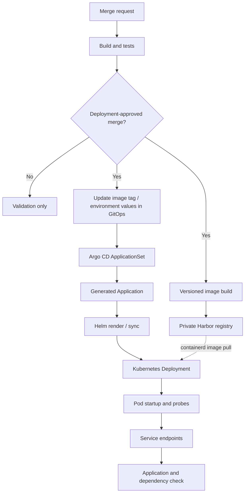

# Where a GitOps deployment can fail

This is a simplified map of the delivery path I worked with. It leaves out private repositories, namespaces, hosts, and registry addresses. It also separates the **image** path from the **configuration** path—two things that are easy to confuse when a rollout fails.

## What I checked when a deployment did not come up

| Observation | First place to investigate | What it does not prove |
| --- | --- | --- |
| CI passed | Artifact tag and registry push | That the registry contains the tag |
| Harbor has the image | Pull credentials, CA trust and node connectivity | That Kubernetes can pull it |
| GitOps commit exists | ApplicationSet generation, target namespace, effective values | That Argo CD synced the change |
| Argo CD reports Synced | Pod events, image and config references | That the application started |
| Pod is Running | Readiness, logs, dependencies and Service endpoints | That a business request succeeds |

## A concrete troubleshooting lesson

On a multi-service rollout, it was tempting to interpret **Argo CD Synced** as deployment success. That was not enough. A generated Application could target the intended namespace and revision while a pod still sat in `ImagePullBackOff` or `ContainerCreating`. I checked the generated Application, image tag, pull events, runtime configuration and finally the application path before calling the change complete.

I also kept the shared Helm chart separate from per-service and per-environment values. That made it possible to inspect a service-specific failure without editing the common deployment template for every application.

## Operational boundaries

- A direct change to a Kubernetes object may help diagnose a problem, but the corresponding GitOps values must be reconciled afterward to prevent drift.
- Registry trust and authentication are different problems: a valid pull Secret does not solve an untrusted registry CA.
- A source-control event does not necessarily deploy. The trigger and branch/merge conditions matter.
- This diagram illustrates the operating pattern, **not** a claim that every stage has publicly reproducible end-to-end tests.

Related: [CI/CD and GitOps delivery](ci-cd-gitops.md) and [operations/recovery](operations-recovery.md).
